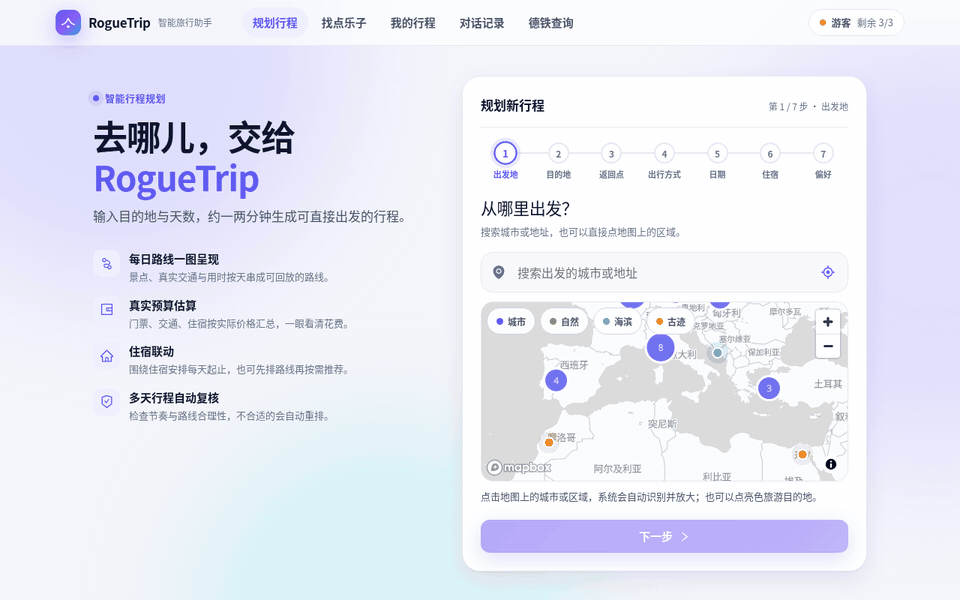

# RogueTrip

Trip planner that turns a few inputs (where from, where to, dates, how you travel, where you sleep, what you like) into a day-by-day itinerary with real routes, opening hours and a cost estimate.

Live: https://ai.roguelife.de (guests get 3 plans per day). The repo still has the project's early name, eztrip.



I started this in spring 2026 from a small agent demo with an Amap backend. Since then most of it has been rewritten: Europe-focused maps (Mapbox + Google Places), Deutsche Bahn data, a review loop for the generated plans and a lot of plain code around the LLM calls so the output can actually be used on a trip.

## What it does

- 7-step planner: origin, destination(s), return point, transport mode, dates, accommodation, preferences
- Multi-city trips, each stop planned separately and then stitched together
- Route per day on a map, with playback of the legs
- Accommodation by segment: pick an area first, then a concrete hotel; days are re-ordered around where you sleep
- Budget for tickets, transport and hotels, per person and for the group. Prices come from a pricing service when available, otherwise they are marked as estimates
- Intercity route comparison (public transport incl. Deutschlandticket check vs. driving)
- Opening hours check against the travel dates
- Deutsche Bahn timetable questions in plain language ("next train from Duisburg to Köln after 18:00")
- Optional travel tips from Xiaohongshu posts, always shown with their source
- Guest quota per IP, owner login via htpasswd

## How a plan is generated

```
request ──> supervisor (tool-calling loop)
              ├─ poi_scout     places via Google Places
              ├─ food_scout    restaurants near the day's anchors
              └─ xhs_insight   tips from Xiaohongshu (optional, degrades to nothing)
         ──> candidate pool, kept server side
         ──> composer         one LLM call per day, in parallel, strict JSON
         ──> polish / settle  plain code: meal times, duplicates, first/last leg,
                              arrival times, car pick-up/return, what doesn't fit
         ──> critic           separate model scores the whole trip
         ──> refine           re-plan the days with issues, then review again
                              (max 3 rounds, stops at score >= 85)
         ──> budget, weather, images (read-only, don't change the plan)
```

A few decisions that came out of things breaking:

- The supervisor never writes itinerary JSON. Keeping a 4-5k token JSON intact inside a tool loop failed too often, so it only collects candidates and the composer writes one day at a time.
- Big objects (candidate lists) stay in a per-request context; the model only sees short summaries. Token use dropped a lot and tool arguments stopped getting mangled.
- Numbers are not left to the model. Distances, prices, Deutschlandticket eligibility and budget totals are computed in code. The route advisor may only mention amounts that exist in the data, otherwise its text is dropped.
- Review always runs on the final data. Earlier versions reviewed a draft and then changed it afterwards, which produced reviews that contradicted the delivered plan. Every plan carries a fingerprint; if it changes after review, it gets reviewed again.
- Generation runs as a background job with an SSE event log, so a closed tab or a dropped connection doesn't lose a 2-minute plan.

## Repository layout

```
backend/        FastAPI app
  app/agents/     supervisor, composer, critic, refine loop, DB router agent
  app/services/   routing, budget, stays, transit, opening hours, quality score ...
  app/api/        HTTP + SSE routes
  app/evals/      offline scoring of saved plans (no model calls)
  agent-config/   models, prompts versions and tools per agent role
  tests/
frontend/       the first Vue 3 client (kept for reference, see below)
web-modules/    UI modules used by the current frontend
```

About the frontend: `frontend/` is the original Vue client from the first version. The production UI has moved on since then. The newer parts (stay planner, budget panel, route sync, map camera, Xiaohongshu tips) live in `web-modules/` as plain JS modules and are wired into the built app by `web-modules/build.cjs`.

## Running the backend

Python 3.12+.

```bash
cd backend
pip install -r requirements.txt
cp .env.example .env   # fill in the keys you have
uvicorn app.api.main:app --port 8881
```

Needed at minimum: an OpenAI-compatible LLM endpoint, a Mapbox token and a Google Places key. Deutsche Bahn, Xiaohongshu and the pricing/events services are optional and switch off cleanly when not configured. In my setup all model calls go through a LiteLLM proxy, so the model names in `agent-config/agents.yaml` are proxy aliases.

Tests and the eval set:

```bash
cd backend
python -m unittest discover tests
python -m app.evals --top 8
```

Or with Docker: `docker build -t eztrip-backend backend/` and mount `.env`, `storage/` and `cache/`.

## Not in this repo

The pricing service (hotel quotes, FlixBus/DB prices, route comparison), the local events service and the deployment config run as separate services in my homelab. The DB timetable tools are based on [jorekai/db-timetable-mcp](https://github.com/jorekai/db-timetable-mcp).
